

  

  

  
  <a href="https://github.com/ZayedBH/Mini-Project"></a>
  <a href="https://github.com/Atul013/Lucid"></a>
  <a href="https://github.com/Atul013/forge-room-ide"></a>

  <a href="https://github.com/Atul013/Pazham">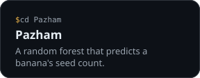</a>
  <a href="https://github.com/Atul013/Cradlix">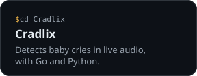</a>
  <a href="https://github.com/Atul013/HackQuest25">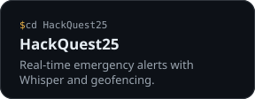</a>

  

  

  
  
  
  
  
  

  

  
  &nbsp;&nbsp;&nbsp;&nbsp;
  
  &nbsp;&nbsp;&nbsp;&nbsp;
  
  &nbsp;&nbsp;&nbsp;&nbsp;
  

